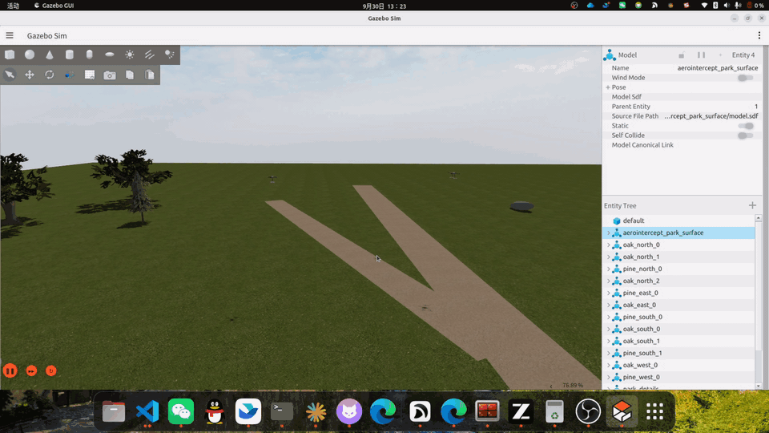
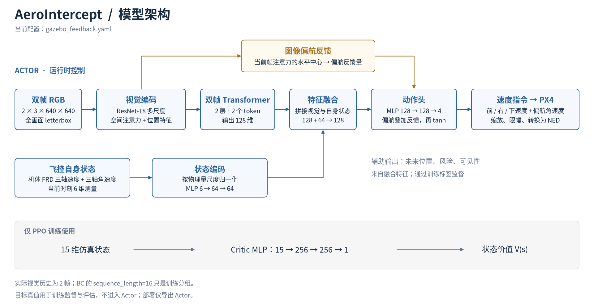

# AeroIntercept

**English** | [简体中文](README.zh-CN.md)

### End-to-End Interception and Simulation Validation for Autonomous UAVs

<div align="center">

[](https://gazebosim.org/)
[](https://px4.io/)
[](https://docs.ros.org/en/humble/)
[](https://pytorch.org/)

</div>

AeroIntercept is a research platform for visual tracking and contact interception of moving UAV targets.
It integrates onboard vision policies, learning algorithms, and Gazebo/PX4 physics simulation
into a trainable and evaluable system. The policy takes consecutive RGB images and the UAV's
own flight state as input, and outputs 3D velocity and yaw-rate commands.

## Key Features

- **Vision and flight-state fusion**: Two RGB frames provide visual information, while linear and angular velocities describe the UAV's own motion.
- **End-to-end control**: ResNet-18 multiscale encoding, spatial attention, and a Transformer jointly produce actions without a separate target detector.
- **Learning and simulation loop**: Includes entry points for expert data collection, behavior cloning (BC), asymmetric Actor-Critic PPO, and model export.
- **Multiple evaluation scenarios**: Supports circular, sinusoidal, smooth random-walk, figure-eight, and stop-and-go target motion, with separate training and held-out scenarios.

## Demo

<div align="center">
  
</div>

## Model Architecture



The Actor takes two **640 × 640 RGB** frames and a **6-dimensional flight state**
(three-axis linear velocity and three-axis angular velocity). ResNet-18 multiscale encoding
and a two-frame Transformer fuse these inputs to produce control actions. Image attention
provides yaw feedback, and auxiliary prediction heads are used only for training supervision.
A separate Critic is used only during PPO training; target ground truth is never fed to the Actor.

## Simulation Environment

Built on **Gazebo Harmonic + PX4 SITL + ROS 2 Humble**, the environment features two x500 UAVs
in a park scene. The target follows constrained cooperative motion, while the interceptor
executes policy velocity commands through the PX4 Offboard interface.
Each episode starts with approximately **10 m** between the UAV centers. Success is defined
as physical contact or a minimum center-to-center distance of **≤0.5 m** within a simulation step.

## Closed-Loop Results

The retained checkpoint (a BC model trained with corrective data from five scenarios) was evaluated
on five target motion patterns, with four episodes per pattern in a development evaluation
(`contact_intercept_v1`, seed 10000):

| Target Motion | Circular | Sinusoidal | Random Walk | Figure Eight | Stop and Go | Overall |
|---|---|---|---|---|---|---|
| Hit Rate | 3/4 | 4/4 | 2/4 | 0/4 | 3/4 | **12/20 (60%)** |

Successful episodes reached contact in an average of **2.4–3.0 s** of simulation time.
Failures were mainly associated with vegetation contact, targets leaving the camera view,
and target loss. The figure-eight scenario remains a weakness; a repeat evaluation with an
independent seed achieved 10/20. The project is still in the research validation stage.
See [Results and Acceptance Criteria](assets/docs/RESULTS.md) for formal acceptance criteria
and per-episode data.

## Quick Start

Follow the [Usage Guide](assets/docs/GUIDE.md) to set up simulation dependencies and the Python
environment, then verify the machine-specific paths in the
[main configuration](configs/gazebo_feedback.yaml). Datasets and training artifacts are not
distributed through Git. The retained checkpoint, `assets/models/best.pt`, is included in the repository.

From the project root, activate the environment and launch the visual demo:

```bash
conda activate AeroIntercept

python -m aerointercept.gazebo.scripts.evaluate \
  --launch --device cuda:0 \
  --config configs/gazebo_feedback.yaml \
  --checkpoint assets/models/best.pt \
  --mode circle --episodes 4 --seed 10016 \
  --output "artifacts/runs/experiments/demo_$(date +%Y%m%d_%H%M%S)/evaluation.json"
```

Supported `--mode` values are `circle / sinusoidal / random_walk / figure_eight / stop_go`.
Add `--headless` to disable the graphical interface, or press `Ctrl+C` to stop the run.

## Project Structure

| Directory | Contents |
|---|---|
| `aerointercept/` | Policy models, training algorithms, simulation interfaces, and evaluation tools |
| `configs/` | Model, training, and simulation configurations |
| `assets/` | Scene assets, architecture figures, and project documentation |
| `tests/` | Regression tests |

The local `artifacts/` directory stores datasets, trained checkpoints, and evaluation reports
(not distributed through Git). See [Results and Acceptance Criteria](assets/docs/RESULTS.md)
for training results, closed-loop evaluations, and formal acceptance criteria.
